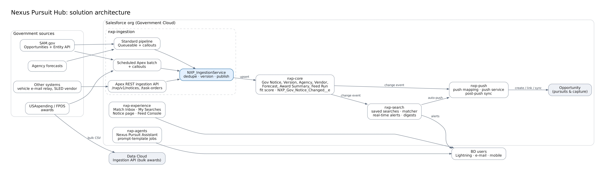

# Nexus Pursuit Hub

Government opportunity intelligence on Salesforce. Nexus Pursuit Hub replaces the GovWin IQ subscription:

- **Feeds:** it ingests government feeds (SAM.gov, agency forecasts, USAspending awards, SAM.gov entities).
- **Searches:** each user builds their own saved searches and gets alerts on matches.
- **Push:** chosen notices go into **TechnoMile**, which keeps managing opportunities and capture.



|           |                                                                                                                               |
| --------- | ----------------------------------------------------------------------------------------------------------------------------- |
| Platform  | Salesforce (Government Cloud supported), Salesforce DX source format, **API 68.0**                                            |
| Naming    | Every object and component starts with `NXP_` (LWCs: `nxp` + camelCase)                                                       |
| Packaging | Six unlocked packages, no namespace. They can also be deployed straight from source with `sf project deploy`.                 |
| AI        | Agentforce assistant built manually in Agentforce Builder; prompt templates run by batch Apex; Agent Script kept as reference |
| Release   | Scripted `sf` commands (`scripts/release.sh`), no CI/CD pipeline                                                              |

## What it does

| Capability                                                                                                             | Where                                                                   |
| ---------------------------------------------------------------------------------------------------------------------- | ----------------------------------------------------------------------- |
| **Standard feeds:** SAM.gov opportunities, entities, forecasts and USAspending awards                                  | `nxp-ingestion` connectors on a Queueable pipeline or a scheduled batch |
| **Additional import channels:** Apex REST ingestion API, scheduled Apex batch, Apex callouts, Data Cloud Ingestion API | `/services/apexrest/nxp/v1/notices`, `NXP_FeedFetchBatch`, `datacloud/` |
| Dedupe across sources, amendment versioning, change events                                                             | `NXP_IngestionService`                                                  |
| Rules-based fit score against the company profile                                                                      | `NXP_FitScoreService`, `NXP_Fit_Rule__mdt`                              |
| User-built saved searches with boolean keywords, live preview and a 13-week back-test                                  | **My Searches** tab (`nxpSearchBuilder`)                                |
| Real-time, daily and weekly alerts; follow alerts                                                                      | `NXP_SearchMatchService`, `NXP_AlertService`, `NXP_DigestBatch`         |
| Match Inbox: push, watch or dismiss                                                                                    | **Match Inbox** tab (`nxpMatchInbox`)                                   |
| Push to TechnoMile: manual, bulk, auto-push rules and post-push sync                                                   | `nxp-push`, `NXP_Push_Mapping__mdt`                                     |
| Nexus Pursuit Assistant (Agentforce) and AI summaries                                                                  | `nxp-agents`                                                            |
| Feed health and Run now for admins                                                                                     | **Feed Console** tab (`nxpFeedConsole`)                                 |

## Repository layout

```text
packages/
  nxp-core/        objects, metadata types, platform event, shared Apex, fit score
  nxp-ingestion/   connectors, pipeline, batches, Apex REST API, credentials, feed config
  nxp-search/      saved searches, matcher, alerts, digests
  nxp-push/        push target, push service, post-push sync, push mappings
  nxp-experience/  Lightning app, tabs, record page, LWCs
  nxp-agents/      agent actions, AI jobs, permission sets
    reference/     Agent Script + prompt templates (not deployed in Government Cloud)
env-config/<env>/  per-environment settings (each a small DX project)
datacloud/         Ingestion API schema and bulk upload script
data/              seed data and API fixtures
scripts/           install, sample data, functional test, validate, release, uninstall (.sh and .ps1)
docs/              architecture, design, guides, deployment, ADRs, diagrams (JPG)
```

## Quick start (development)

Prerequisites: VS Code with the Salesforce Extension Pack, Salesforce CLI (`sf`), Node 20+, and a Dev Hub or developer sandbox.

```bash
git clone https://github.com/Hectorcaban-sudo/Nexus-Pursuit-Hub.git
cd Nexus-Pursuit-Hub
npm install
sf org login web --alias nxp-devhub --set-default-dev-hub
scripts/dev-setup.sh                 # scratch org "nxp-dev" with sample data
# or: scripts/dev-setup.sh --org my-sandbox
```

Windows PowerShell:

```powershell
.\scripts\dev-setup.ps1                    # or: .\scripts\dev-setup.ps1 -Org my-sandbox
```

Then add your SAM.gov API key. In **Setup → Named Credentials → External Credentials → NXP SAM.gov → Principals → Default**, add an authentication parameter named `ApiKey`.

Test it with the sample data, then run the pre-PR checks:

```bash
scripts/test-functional.sh --org nxp-dev   # REST API + end-to-end checks   (.\scripts\test-functional.ps1 -Org nxp-dev)
scripts/validate.sh --org nxp-dev          # Prettier, ESLint, Jest, check-only deploy with Apex tests
```

Every script has a PowerShell twin; see [scripts/README.md](scripts/README.md). The [testing guide](docs/guides/testing-guide.md#test-with-sample-data) explains the sample data and has a walkthrough of every screen. To remove Nexus from an org: `scripts/uninstall.sh --org <alias>` ([uninstall](docs/deployment/deployment-guide.md#uninstall)).

## Documentation

Start at **[docs/README.md](docs/README.md)**. The most-used pages:

| Audience      | Read                                                                                                                                                                      |
| ------------- | ------------------------------------------------------------------------------------------------------------------------------------------------------------------------- |
| Everyone      | [Solution architecture](docs/architecture/solution-architecture.md) · [Functional design](docs/design/functional-design.md)                                               |
| Developers    | [Developer guide](docs/guides/developer-guide.md) · [Technical architecture](docs/architecture/technical-architecture.md) · [Testing guide](docs/guides/testing-guide.md) |
| Admins        | [Admin guide](docs/guides/admin-guide.md) · [Agent manual build](docs/guides/agent-manual-build.md)                                                                       |
| Release leads | [Deployment guide](docs/deployment/deployment-guide.md) · [Post-deployment checklist](docs/deployment/post-deployment-checklist.md)                                       |
| Integrators   | [REST ingestion API](docs/integration/rest-ingestion-api.md) · [Data Cloud ingestion](docs/integration/data-cloud-ingestion.md)                                           |
| BD users      | [User guide](docs/guides/user-guide.md)                                                                                                                                   |

## Status

Version 1.0.0, first build:

- **Checked here:**
    - All Apex parses (prettier-plugin-apex).
    - All XML is well-formed.
    - 33 Jest tests pass (in several time zones) and ESLint is clean.
    - Every bash and PowerShell script parses, and each was run against a stand-in `sf` CLI and REST endpoint to check its commands and results.
- **Not yet run:** the code has not been deployed to an org from this repository. Run `scripts/validate.sh --org <org>` first; it compiles everything and runs every Apex test.
- **Org-specific settings:** the push target and the TechnoMile field mapping must be set per org. See the [admin guide](docs/guides/admin-guide.md#push-mapping).
