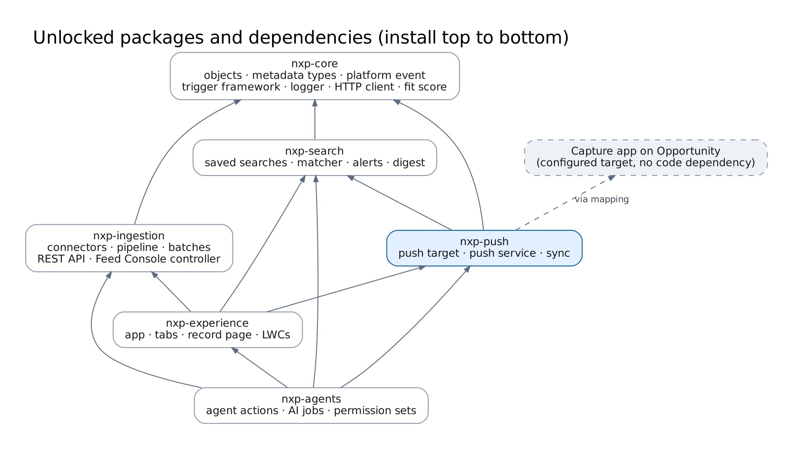

# Technical architecture

## Packages

| Package          | Contents                                                                                                                                                                                                                                                                                                                                              | Depends on                    |
| ---------------- | ----------------------------------------------------------------------------------------------------------------------------------------------------------------------------------------------------------------------------------------------------------------------------------------------------------------------------------------------------- | ----------------------------- |
| `nxp-core`       | 12 custom objects, 5 custom metadata types, `NXP_Gov_Notice_Changed__e`, custom permissions, notification type, trigger framework, logger, HTTP client, JSON helpers, settings, fit score, preview tokens, notice selector                                                                                                                            | —                             |
| `nxp-ingestion`  | Connector interface and four connectors, ingestion service, agency resolver, Queueable pipeline + finalizer, batch channel, scheduler, enrich batch, Apex REST resources, feed run service, Feed Console controller, Named/External Credentials, feed configs and mappings, eBuy e-mail handler, parser and extraction job, Inbound Emails controller | core                          |
| `nxp-search`     | Saved Search, Search Match, Follow; keyword expression parser, criteria, query builder, matcher, alert service, digest batch, criteria draft service, sharing service, controller, platform-event trigger and subscriber config                                                                                                                       | core                          |
| `nxp-push`       | Push Log; push target interface, mapping-driven TechnoMile target, push service, auto-push listener and job, retry job, post-push sync trigger, controller, push mappings                                                                                                                                                                             | core, search                  |
| `nxp-experience` | Lightning app, tabs, Gov Notice record page, 7 LWCs, notice controller                                                                                                                                                                                                                                                                                | core, ingestion, search, push |
| `nxp-agents`     | 11 invocable agent actions, AI service, Notice Analyst job, permission sets; `reference/` holds Agent Script and prompt templates                                                                                                                                                                                                                     | all of the above              |

TechnoMile is not a code dependency. The push target object and fields come from `NXP_Push_Mapping__mdt`, so every package installs and tests without TechnoMile.

## Apex layers

| Layer           | Rule                                                                                                                                   | Examples                                                                                                                  |
| --------------- | -------------------------------------------------------------------------------------------------------------------------------------- | ------------------------------------------------------------------------------------------------------------------------- |
| Trigger         | One per object, no logic                                                                                                               | `NXP_GovNoticeTrigger`, `NXP_GovNoticeChangedTrigger`, `NXP_PostPushSyncTrigger`                                          |
| Trigger handler | Extends `NXP_TriggerHandler`; can be bypassed in code or with `NXP_Setting` `Bypass_<Handler>`                                         | `NXP_GovNoticeTriggerHandler`                                                                                             |
| Service         | Use cases and transaction boundaries                                                                                                   | `NXP_IngestionService`, `NXP_SearchMatchService`, `NXP_PushService`, `NXP_FitScoreService`                                |
| Selector        | Shared field list, caller picks `USER_MODE` or `SYSTEM_MODE`                                                                           | `NXP_GovNoticeSelector`                                                                                                   |
| Integration     | Connectors behind `NXP_FeedConnector`; HTTP via `NXP_HttpClient` and Named Credentials                                                 | `NXP_SamOpportunityConnector`, `NXP_UsaSpendingConnector`, `NXP_ForecastConnector`, `NXP_SamEntityConnector`              |
| Async           | Queueable chain + Finalizer (standard pipeline); `Database.Batchable` with `AllowsCallouts` + `Stateful` (batch channel); Schedulables | `NXP_FeedFetchJob`, `NXP_FeedFetchBatch`, `NXP_FeedScheduler`, `NXP_DigestBatch`, `NXP_NoticeAnalystJob`                  |
| Controllers     | `@AuraEnabled`, `with sharing`, user mode                                                                                              | `NXP_SearchController`, `NXP_PushController`, `NXP_FeedConsoleController`, `NXP_NoticeController`, `NXP_MarketController` |
| Agent actions   | `@InvocableMethod`, thin wrappers over services                                                                                        | `NXP_PreviewPushAction`, `NXP_PushToTechnoMileAction`, …                                                                  |
| REST            | `@RestResource`, delegate to `NXP_RestIngestSupport`                                                                                   | `NXP_NoticeIngestResource`, `NXP_TaskOrderIngestResource`, `NXP_FeedRunResource`                                          |

## Extension points

| To add                        | Do this                                                                                                                                                                                                       |
| ----------------------------- | ------------------------------------------------------------------------------------------------------------------------------------------------------------------------------------------------------------- |
| A new feed                    | Write a class implementing `NXP_FeedConnector` (init, initialCheckpoint, fetchPage). Add an `NXP_Feed_Config__mdt` record and `NXP_Feed_Mapping__mdt` rows. The pipeline, batch and scheduler need no change. |
| A new source that pushes data | No code: the source calls the REST API with its own `source` name.                                                                                                                                            |
| A reaction to new matches     | Implement `NXP_MatchListener` and add the class name to `NXP_Setting` `Match_Listeners`.                                                                                                                      |
| A different push target       | Change `NXP_Push_Mapping__mdt` (object and fields). For non-mapping behaviour, implement `NXP_PushTarget`.                                                                                                    |
| Document reading              | `NXP_DocumentAnalyzer` (core) is implemented by `NXP_DocumentAnalysisJob` (agents) and found by name, like the eBuy extractor.                                                                                |
| AI extraction for e-mail      | Implement `NXP_EbuyAiExtractor` in a class named `NXP_EbuyAiExtract` (shipped in `nxp-agents`); `NXP_EbuyExtractJob` finds it by name, so `nxp-ingestion` does not depend on the agents package.              |
| A new fit rule type           | Add a picklist value to `NXP_Fit_Rule__mdt.Rule_Type__c` and a `when` branch in `NXP_FitScoreService`.                                                                                                        |

## Events and asynchronous work

| Trigger                                  | Runs                                           | Purpose                                                |
| ---------------------------------------- | ---------------------------------------------- | ------------------------------------------------------ |
| `NXP_FeedScheduler` (hourly at :05)      | Queueable or batch per due feed                | Feed runs                                              |
| Feed run finishes (SAM feeds)            | `NXP_NoticeEnrichBatch`                        | Replace description links with text                    |
| `NXP_Gov_Notice_Changed__e`              | `NXP_GovNoticeChangedTrigger` (batch size 200) | Matching, alerts, follow alerts, AI request, listeners |
| `NXP_Gov_Notice_Changed__e`              | `NXP_PostPushSyncTrigger`                      | Sync records already pushed                            |
| New auto-push matches                    | `NXP_AutoPushJob` (Queueable)                  | Push as search owner                                   |
| `NXP Daily Digest` / `NXP Weekly Digest` | `NXP_DigestBatch`                              | Digest e-mails                                         |
| `NXP Notice Analyst :15` and `:45`       | `NXP_NoticeAnalystJob`                         | AI summaries and amendment summaries                   |
| `NXP Push Retry` (:20)                   | `NXP_PushRetryJob`                             | Retry failed auto-pushes                               |

## Governor-limit design

- **Callouts:** one page per Queueable job or batch `execute()`; entity refresh caps at 90 callouts per transaction. Callouts always happen before DML in a transaction.
- **Checkpoints:** stored on `NXP_Feed_Run__c.Checkpoint__c`, so a failed page resumes on the next run.
- **Matching:** event-driven in batches of 200 notices against all active searches. Each user has a limit on saved searches (`Max_Searches_Per_User`, `Max_RealTime_Searches`) to bound CPU.
- **Previews:** SOQL narrows with indexed filters (status, type, NAICS/PSC, dates, value) to at most 2,000 rows, then Apex applies agency, set-aside and keyword filters.
- **Change detection:** a SHA-256 hash of tracked fields avoids writing versions for unchanged records. A description that is still a link is ignored, so fetching its text never looks like an amendment.

## Naming

| Item                                                        | Convention                  | Example                                                               |
| ----------------------------------------------------------- | --------------------------- | --------------------------------------------------------------------- |
| Objects, metadata types, events                             | `NXP_` + name               | `NXP_Gov_Notice__c`, `NXP_Fit_Rule__mdt`, `NXP_Gov_Notice_Changed__e` |
| Fields on NXP_ objects                                      | Business name, no prefix    | `Response_Due__c`                                                     |
| Fields added to other objects                               | `NXP_` prefix               | `NXP_Solicitation_Number__c` on the TechnoMile object                 |
| Apex classes and triggers                                   | `NXP_` + PascalCase + layer | `NXP_PushService`, `NXP_IngestionTest`                                |
| LWC                                                         | `nxp` + camelCase           | `nxpSearchBuilder`                                                    |
| Permission sets, custom permissions, credentials, tabs, app | `NXP_` prefix               | `NXP_Admin`, `NXP_Power_User`, `NXP_SAM_Gov`, `NXP_Pursuit_Hub`       |
| REST URLs                                                   | `/nxp/v1/...`               | `/services/apexrest/nxp/v1/notices`                                   |
