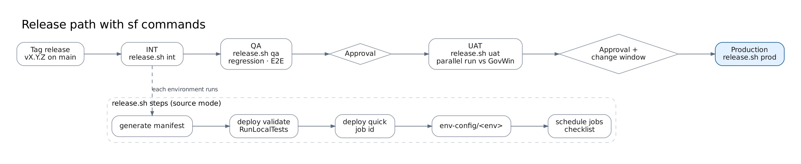

# Deployment guide

How to install, release, test, roll back and remove Nexus Pursuit Hub with scripted `sf` commands. There is no CI/CD pipeline. Every script has a bash version (`.sh`, for macOS, Linux, WSL or Git Bash) and a PowerShell version (`.ps1`, for Windows PowerShell 5.1 or PowerShell 7). Both run the same `sf` commands.



## Contents

1. [Choose a release path](#choose-a-release-path)
2. [Scripts at a glance](#scripts-at-a-glance)
3. [Prerequisites](#prerequisites)
4. [First install in an org](#first-install-in-an-org)
5. [Release with source deploy](#release-with-source-deploy)
6. [Release with unlocked packages](#release-with-unlocked-packages)
7. [Test after a deployment](#test-after-a-deployment)
8. [Sandbox refresh](#sandbox-refresh)
9. [Rollback](#rollback)
10. [Agent release](#agent-release)
11. [Uninstall](#uninstall)
12. [Troubleshooting](#troubleshooting)

## Choose a release path

The same six package folders (`packages/nxp-core` … `packages/nxp-agents`) can be released two ways. Pick one per org and stay with it: components installed by a package can't later be replaced by plain source deploys.

|           | Source deploy (default)                                                                            | Unlocked packages                                                        |
| --------- | -------------------------------------------------------------------------------------------------- | ------------------------------------------------------------------------ |
| Unit      | One metadata deployment of all six folders                                                         | Six package versions, installed in dependency order                      |
| Tests     | `RunLocalTests` during validation                                                                  | Coverage checked at version creation; `RunLocalTests` recommended in UAT |
| Rollback  | Redeploy the previous Git tag; remove new components with a destructive manifest                   | Reinstall the previous promoted versions                                 |
| Uninstall | `uninstall` script, source mode                                                                    | `uninstall` script, package mode                                         |
| Best for  | Change boards that approve metadata deployments; hotfixes; Government Cloud orgs without a Dev Hub | Long-term upgrades and clean uninstalls                                  |

## Scripts at a glance

Run them from the repository root (they change there themselves). Help: `scripts/<name>.sh --help` or `Get-Help .\scripts\<name>.ps1 -Detailed`. Full list: [scripts/README.md](../../scripts/README.md).

| Task                                  | Bash                                                  | PowerShell                                                            |
| ------------------------------------- | ----------------------------------------------------- | --------------------------------------------------------------------- |
| Install into a scratch org or sandbox | `scripts/dev-setup.sh --org <alias>`                  | `.\scripts\dev-setup.ps1 -Org <alias>`                                |
| Pre-release checks                    | `scripts/validate.sh --org <alias>`                   | `.\scripts\validate.ps1 -Org <alias>`                                 |
| Release, source deploy                | `scripts/release.sh <env> <alias>`                    | `.\scripts\release.ps1 -Environment <env> -Org <alias>`               |
| Release, packages                     | `scripts/release.sh <env> <alias> package`            | `.\scripts\release.ps1 -Environment <env> -Org <alias> -Mode package` |
| Create package versions               | `scripts/create-package-versions.sh <devhub>`         | `.\scripts\create-package-versions.ps1 -DevHub <devhub>`              |
| Load, reset or delete sample data     | `scripts/load-sample-data.sh --org <alias> [--reset]` | `.\scripts\load-sample-data.ps1 -Org <alias> [-Reset]`                |
| Functional test                       | `scripts/test-functional.sh --org <alias>`            | `.\scripts\test-functional.ps1 -Org <alias>`                          |
| Uninstall                             | `scripts/uninstall.sh --org <alias>`                  | `.\scripts\uninstall.ps1 -Org <alias>`                                |

`<env>` is `dev`, `qa`, `uat` or `prod` and selects `env-config/<env>` ([environments](environments.md)).

## Prerequisites

**On your computer**

| Tool                              | Check               | Install                                                            |
| --------------------------------- | ------------------- | ------------------------------------------------------------------ |
| Salesforce CLI                    | `sf --version`      | `npm install --global @salesforce/cli`                             |
| Node.js 20+ and npm               | `node --version`    | nodejs.org; then `npm install` in the repo                         |
| Git                               | `git --version`     | git-scm.com                                                        |
| Bash _or_ PowerShell              | —                   | Bash: macOS, Linux, WSL, Git Bash. PowerShell: built into Windows  |
| Python 3 (bash `release.sh` only) | `python3 --version` | Reads JSON in `release.sh`; the PowerShell version doesn't need it |

On Windows, if PowerShell refuses to run scripts, allow local scripts once for your user:

```powershell
Set-ExecutionPolicy -Scope CurrentUser RemoteSigned
# Only if you downloaded the repo as a ZIP instead of cloning it:
Get-ChildItem -Recurse scripts, datacloud -Filter *.ps1 | Unblock-File
```

**In each target org**

- **API version:** the org is on the Salesforce release that supports **API 68.0**. Check with `sf org display --target-org <alias>` (_Api Version_). Check sandboxes too; an org on an older release rejects 68.0 metadata.
- **Deploying user:** a System Administrator.
- **Deployment setting:** **Setup → Deployment Settings → Allow deployments of components when corresponding Apex jobs are pending or in progress** is on. Without it, the second and later releases fail because the scheduled NXP jobs refer to the classes being deployed. If your org can't turn it on, run `unschedule-jobs.apex` before each release (see [Troubleshooting](#troubleshooting)).
- **Org features:** Platform Events and Custom Notifications (both standard). Einstein / Agentforce only for AI summaries and the assistant. Data Cloud only for the Data Cloud ingestion channel.

**Log in once per org** (for Government Cloud, use your org's My Domain URL):

```bash
sf org login web --alias nxp-uat --instance-url https://<my-domain>.my.salesforce.com
sf org list                                  # check the alias is connected
```

The same commands work in PowerShell.

## First install in an org

Do this once per org. Later releases only need [Release with source deploy](#release-with-source-deploy) or [unlocked packages](#release-with-unlocked-packages).

**Dev, INT or a scratch org:** `dev-setup` does steps 1–4 and 7, and loads the sample data:

```bash
scripts/dev-setup.sh                         # new scratch org "nxp-dev"
scripts/dev-setup.sh --org my-sandbox        # existing sandbox
```

```powershell
.\scripts\dev-setup.ps1                      # new scratch org "nxp-dev"
.\scripts\dev-setup.ps1 -Org my-sandbox      # existing sandbox
```

**QA, UAT or production:**

1. **Deploy:** `scripts/release.sh <env> <alias>` or `.\scripts\release.ps1 -Environment <env> -Org <alias>`. This deploys the packages and `env-config/<env>` and schedules the jobs.
2. **Permission sets:** assign them to people.

    | Permission set    | Who                                                                    |
    | ----------------- | ---------------------------------------------------------------------- |
    | `NXP_User`        | Every BD user                                                          |
    | `NXP_Power_User`  | Capture leads (bulk push, auto-push, team searches); add to `NXP_User` |
    | `NXP_Admin`       | Nexus administrators (Feed Console run now, settings, all records)     |
    | `NXP_Integration` | The REST integration user only                                         |

    ```bash
    sf org assign permset --name NXP_User --name NXP_Admin --target-org nxp-uat --on-behalf-of admin@example.gov
    ```

3. **SAM.gov API key:** **Setup → Named Credentials → External Credentials → NXP SAM.gov → Principals → Default**: add an authentication parameter named `ApiKey`.
4. **Forecasts endpoint:** set the URL on the `NXP_Forecasts` Named Credential and check the `FC_*` Feed Mapping records against your forecast source.
5. **Company Profile:** create one active **Company Profile** (NAICS, PSC, set-asides, target agencies, keywords, value range), then score existing notices: `sf apex run --file scripts/apex/rescore-notices.apex --target-org <alias>`.
6. **Push mapping:** point the `NXP_Push_Mapping` records at the TechnoMile object and fields ([admin guide](../guides/admin-guide.md#push-mapping)).
7. **Jobs:** already scheduled by `release` / `dev-setup`. To run it alone: `sf apex run --file scripts/post-deploy/schedule-jobs.apex --target-org <alias>`, as an `NXP_Admin` user.
8. **Optional channels:** REST integration user and External Client App ([REST API](../integration/rest-ingestion-api.md)); Data Cloud connector ([Data Cloud ingestion](../integration/data-cloud-ingestion.md)); prompt templates and `AI_Enabled`; the assistant ([agent manual build](../guides/agent-manual-build.md)).
9. **Check:** [Test after a deployment](#test-after-a-deployment), then the [post-deployment checklist](post-deployment-checklist.md) (_First release in an org_ section).

## Release with source deploy

```bash
git switch main && git pull
git tag v1.0.1 && git push --tags
scripts/validate.sh --org nxp-qa             # optional dry run: lint, Jest, check-only deploy with tests
scripts/release.sh uat nxp-uat
```

```powershell
git switch main; git pull
git tag v1.0.1; git push --tags
.\scripts\validate.ps1 -Org nxp-qa
.\scripts\release.ps1 -Environment uat -Org nxp-uat
```

The release script:

1. **Generates the manifest** `manifest/release-<tag>.xml`, to attach to the change record.
2. **Validates** with `sf project deploy validate` and `RunLocalTests`. Nothing is saved yet. Prints the job ID.
3. **Asks before it quick-deploys** (`sf project deploy quick --job-id <id>`), without re-running tests. Answer `no` to stop, then quick-deploy later inside the change window while the validation is still valid (usually 10 days): `sf project deploy quick --job-id <id> --target-org <alias>`.
4. **Logs the deployment** in `manifest/deployments.log`.
5. **Deploys `env-config/<env>`**: feed switches, `Org_Environment`, `AI_Enabled`.
6. **Schedules the jobs** (`scripts/post-deploy/schedule-jobs.apex`; existing NXP jobs are replaced).

Then [test](#test-after-a-deployment) and complete the [post-deployment checklist](post-deployment-checklist.md).

<details>
<summary>Manual equivalent (no scripts)</summary>

```bash
sf project deploy validate --source-dir packages/nxp-core packages/nxp-ingestion packages/nxp-search \
  packages/nxp-push packages/nxp-experience packages/nxp-agents \
  --target-org nxp-prod --api-version 68.0 --test-level RunLocalTests --wait 90
sf project deploy quick --job-id 0Af... --target-org nxp-prod
(cd env-config/prod && sf project deploy start --source-dir force-app --target-org nxp-prod --api-version 68.0)
sf apex run --file scripts/post-deploy/schedule-jobs.apex --target-org nxp-prod
```

```powershell
sf project deploy validate --source-dir packages/nxp-core packages/nxp-ingestion packages/nxp-search `
  packages/nxp-push packages/nxp-experience packages/nxp-agents `
  --target-org nxp-prod --api-version 68.0 --test-level RunLocalTests --wait 90
sf project deploy quick --job-id 0Af... --target-org nxp-prod
Push-Location env-config/prod; sf project deploy start --source-dir force-app --target-org nxp-prod --api-version 68.0; Pop-Location
sf apex run --file scripts/post-deploy/schedule-jobs.apex --target-org nxp-prod
```

</details>

## Release with unlocked packages

Needs a Dev Hub (usually production). Log in to it once: `sf org login web --alias nxp-devhub --set-default-dev-hub`.

**One-time setup: create the six packages.** This adds their IDs to `packageAliases` in `sfdx-project.json`; commit that change.

```bash
for p in nxp-core nxp-ingestion nxp-search nxp-push nxp-experience nxp-agents; do
  sf package create --name $p --package-type Unlocked --path packages/$p --no-namespace --target-dev-hub nxp-devhub
done
```

```powershell
.\scripts\create-package-versions.ps1 -DevHub nxp-devhub -CreatePackages   # creates the packages and their first versions
```

**Each release:**

1. Raise `versionNumber` in `sfdx-project.json` for each package that changed.
2. Create the versions, in dependency order, with code coverage:
   `scripts/create-package-versions.sh nxp-devhub` or `.\scripts\create-package-versions.ps1 -DevHub nxp-devhub` (add an installation key with `[key]` / `-InstallationKey`).
3. Copy `release/versions.example.json` to `release/versions.json` and list the new version aliases (`nxp-core@1.0.1-1`, …) in install order.
4. Install in QA: `scripts/release.sh qa nxp-qa package` or `.\scripts\release.ps1 -Environment qa -Org nxp-qa -Mode package`.
5. After QA and UAT pass, promote each version: `sf package version promote --package nxp-core@1.0.1-1 --target-dev-hub nxp-devhub`. Only promoted versions can be installed in production.
6. Install in production: `scripts/release.sh prod nxp-prod package` or `.\scripts\release.ps1 -Environment prod -Org nxp-prod -Mode package`.

## Test after a deployment

| Environment       | Sample data                                   | Automated test                   | Manual                                                                                     |
| ----------------- | --------------------------------------------- | -------------------------------- | ------------------------------------------------------------------------------------------ |
| Dev, INT, scratch | Loaded by `dev-setup`                         | `test-functional`                | As needed                                                                                  |
| QA                | `load-sample-data --reset` after each release | `test-functional --apex-tests`   | [Screen walkthrough](../guides/testing-guide.md#3-walk-through-the-app)                    |
| UAT               | No                                            | Apex tests ran during validation | [Post-deployment checklist](post-deployment-checklist.md) smoke tests, with real feed data |
| Production        | Never (the loader refuses)                    | Apex tests ran during validation | Post-deployment checklist smoke tests                                                      |

```bash
scripts/load-sample-data.sh --org nxp-qa --reset
scripts/test-functional.sh --org nxp-qa --apex-tests
```

```powershell
.\scripts\load-sample-data.ps1 -Org nxp-qa -Reset
.\scripts\test-functional.ps1 -Org nxp-qa -ApexTests
```

The test prints PASS, FAIL, WARN or SKIP per check and exits with code 1 on any failure. What each check covers: [testing guide](../guides/testing-guide.md#test-with-sample-data).

## Sandbox refresh

A refreshed sandbox is a copy of production, including its SAM.gov key and scheduled jobs. After each refresh:

```bash
sf org login web --alias nxp-qa --instance-url https://<my-domain>--qa.sandbox.my.salesforce.com
sf apex run --file scripts/post-deploy/unschedule-jobs.apex --target-org nxp-qa
(cd env-config/qa && sf project deploy start --source-dir force-app --target-org nxp-qa --api-version 68.0)
# Replace the SAM.gov ApiKey with a test key (Setup > Named Credentials > External Credentials > NXP SAM.gov)
sf apex run --file scripts/post-deploy/schedule-jobs.apex --target-org nxp-qa
scripts/load-sample-data.sh --org nxp-qa     # QA and INT only
```

In PowerShell, replace the `(cd …)` line with `Push-Location env-config/qa; sf project deploy start --source-dir force-app --target-org nxp-qa --api-version 68.0; Pop-Location`, and use `.\scripts\load-sample-data.ps1 -Org nxp-qa`.

## Rollback

| Path    | Steps                                                                                                                                                                                                                                                                                          |
| ------- | ---------------------------------------------------------------------------------------------------------------------------------------------------------------------------------------------------------------------------------------------------------------------------------------------- |
| Source  | `git checkout v<previous>`, then run the release script again. Components added by the bad release stay in the org until you remove them: list them in `manifest/destructiveChangesPost.xml` and add `--post-destructive-changes manifest/destructiveChangesPost.xml` to the validate command. |
| Package | Install the previous promoted version of each package that changed, in dependency order (list them in `release/versions.json` and run the release script with package mode).                                                                                                                   |
| Data    | Releases never delete data. Two-step any change that makes a field required (release 1 adds it; release 2 makes it required) so rollback stays possible.                                                                                                                                       |

Before a risky release, pause the feeds and jobs, and resume them afterwards:

```bash
sf apex run --file scripts/post-deploy/unschedule-jobs.apex --target-org nxp-prod
# … release …
sf apex run --file scripts/post-deploy/schedule-jobs.apex --target-org nxp-prod
```

## Agent release

Government Cloud can't deploy Agent Script, so the Nexus Pursuit Assistant is built by hand in each org ([agent manual build](../guides/agent-manual-build.md#step-by-step)), or built once and retrieved into `packages/nxp-agents/main/default/` so it ships with the release. Either way, after deployment:

1. Activate the agent in the target org. Activation is never automatic.
2. Give users access (the `NXP_User` permission set covers the Apex actions).
3. Run the cases in `tests/agents/assistant.yaml` in Agentforce Builder's preview; at least 90% must pass.

## Uninstall

`scripts/uninstall.sh` (or `.\scripts\uninstall.ps1`) removes Nexus Pursuit Hub from an org. It deletes every `NXP_` component and, with the NXP objects, all Nexus records: notices, searches, matches, push logs and feed runs. For a scratch org, delete the org instead: `sf org delete scratch --target-org <alias>`.

**1. Delete what was built by hand.** These refer to Nexus components and block the delete:

- the **Nexus Pursuit Assistant** agent (deactivate, then delete) and its NXP agent actions;
- the NXP prompt templates in Prompt Builder;
- reports, dashboards, flows and list views people built on NXP objects.

**2. Run the script.**

| Installed with                          | Bash                                               | PowerShell                                          |
| --------------------------------------- | -------------------------------------------------- | --------------------------------------------------- |
| Source deploy (`release` / `dev-setup`) | `scripts/uninstall.sh --org nxp-qa`                | `.\scripts\uninstall.ps1 -Org nxp-qa`               |
| Unlocked packages                       | `scripts/uninstall.sh --org nxp-qa --mode package` | `.\scripts\uninstall.ps1 -Org nxp-qa -Mode package` |

It asks you to type the org alias to confirm (`--yes` / `-Yes` skips that), then:

1. Runs `scripts/uninstall/pre-uninstall.apex`: stops the NXP scheduled and queued jobs and removes the NXP permission set assignments.
2. **Source mode:** for each package folder, dependents first (`nxp-agents` … `nxp-core`), generates a manifest of its components and deploys it as `destructiveChangesPost.xml`. **Package mode:** uninstalls each installed `nxp-*` package, dependents first.

Options:

- `--purge` / `-Purge` hard-deletes the objects. Without it, deleted objects stay under **Setup → Object Manager → Deleted Objects** for 15 days. Not allowed in production.
- `--test-level` / `-TestLevel`: production may require `RunLocalTests` when Apex is deleted.

If a step fails, the error names the component that is still in use. Remove that reference and run the script again; components that are already gone are skipped.

**Kept on purpose:** records pushed to TechnoMile (Opportunity) and any Data Cloud data streams for `NXP_Awards`. The SAM.gov API key is removed with the NXP External Credential.

## Troubleshooting

| Symptom                                                                                 | Cause and fix                                                                                                                                                                                                                                                                                                             |
| --------------------------------------------------------------------------------------- | ------------------------------------------------------------------------------------------------------------------------------------------------------------------------------------------------------------------------------------------------------------------------------------------------------------------------- |
| `... is not supported for API version 68.0` or `Invalid version specified`              | The org is on an older Salesforce release. Wait for the org's upgrade; don't lower the API version.                                                                                                                                                                                                                       |
| `This Apex class is referenced by a scheduled job` / `pending or in progress Apex jobs` | Turn on **Allow deployments of components when corresponding Apex jobs are pending or in progress** (Setup → Deployment Settings), or run `unschedule-jobs.apex` before the release and `schedule-jobs.apex` after.                                                                                                       |
| `NXP_PushTest` or `NXP_AgentsTest` fail during validation                               | Opportunity validation rules or required fields in that org. See [testing guide](../guides/testing-guide.md#notes-for-org-specific-failures).                                                                                                                                                                             |
| PowerShell: `running scripts is disabled on this system`                                | `Set-ExecutionPolicy -Scope CurrentUser RemoteSigned` (see [Prerequisites](#prerequisites)).                                                                                                                                                                                                                              |
| `dev-setup`: `AuthCodeExchangeError ... fetch failed` when creating a scratch org       | The scratch org was created, but this computer can't reach its new address (`*.scratch.my.salesforce.com`), usually because of a firewall, proxy or VPN rule. Use a sandbox (`dev-setup -Org <sandbox-alias>`) or have the network team allow that domain. Delete the unused org under **Dev Hub → Active Scratch Orgs**. |
| `sf` not found                                                                          | Install the CLI (`npm install --global @salesforce/cli`) and open a new terminal.                                                                                                                                                                                                                                         |
| `No authorization information found for <alias>`                                        | Log in: `sf org login web --alias <alias> --instance-url https://<my-domain>.my.salesforce.com`.                                                                                                                                                                                                                          |
| Sample data upsert fails with a `LineEnding is invalid` error                           | The CSV files were checked out with Windows line endings. Run `git add --renormalize . ; git checkout -- data/seed` (`.gitattributes` keeps them LF).                                                                                                                                                                     |
| `test-functional`: REST ingestion `HTTP 403`                                            | The user running the test needs `NXP_Admin` or `NXP_Integration` (custom permission `NXP_Integration_Access`).                                                                                                                                                                                                            |
| `test-functional`: _Smoke test: no results were found_                                  | The smoke test didn't finish. Run `sf apex run --file scripts/apex/smoke-test.apex --target-org <alias>` and read the error at the end of the output.                                                                                                                                                                     |
| `test-functional`: WARN on _Event matching_                                             | The platform event subscriber had not run yet, or is suspended: **Setup → Platform Events → NXP Gov Notice Changed → Subscriptions**, then resume it.                                                                                                                                                                     |
| Package install fails with a missing dependency                                         | Install order is core, ingestion, search, push, experience, agents. Check the order in `release/versions.json`.                                                                                                                                                                                                           |
| Uninstall stops on a component that is `in use`                                         | Something built by hand still refers to it (agent action, prompt template, flow, report). Delete that and run the script again.                                                                                                                                                                                           |
