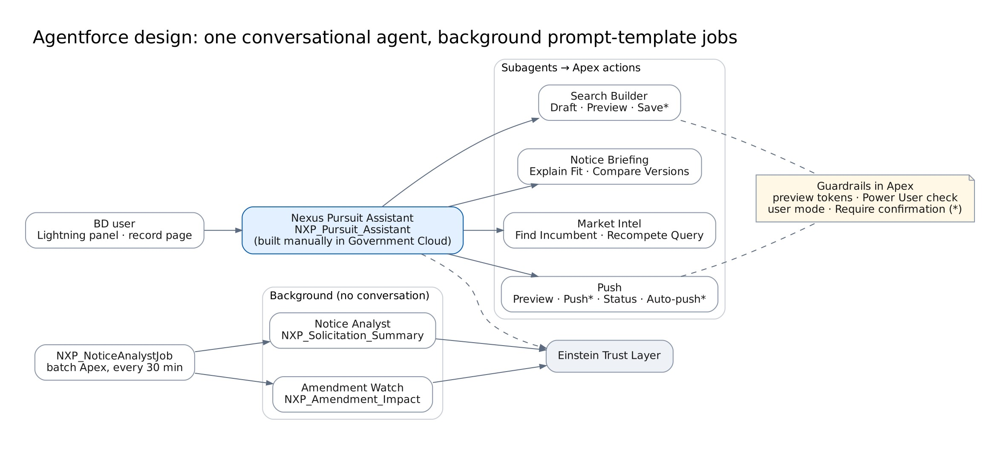

# Agentforce design

In Government Cloud there is **one Agentforce agent**: the Nexus Pursuit Assistant (`NXP_Pursuit_Assistant`), an employee agent with four subagents. It is built manually in Agentforce Builder ([agent manual build guide](../guides/agent-manual-build.md)), because Agent Script is not available there.

The Agent Script blueprint (`packages/nxp-agents/reference/aiAuthoringBundles/`) is kept as the specification and for commercial orgs.

## Subagents and actions

| Subagent        | Handles                                                      | Actions (Apex invocable)                                                                |
| --------------- | ------------------------------------------------------------ | --------------------------------------------------------------------------------------- |
| Search Builder  | Creating, changing, explaining or saving searches and alerts | NXP Draft Search Criteria · NXP Preview Search · NXP Save Search*                       |
| Notice Briefing | A specific notice, its documents, amendments or fit score    | NXP Explain Fit Score · NXP Compare Versions · NXP Notice Documents                     |
| Market Intel    | Incumbents, recompetes, vendors, forecasts                   | NXP Find Incumbent · NXP Recompete Query                                                |
| Push            | Sending notices to Opportunity, push status, auto-push rules | NXP Preview Push · NXP Push To Opportunity* · NXP Push Status · NXP Set Auto-Push Rule* |

\* Turn on **Require user confirmation** in Agentforce Builder.

## Guardrails (enforced in Apex, not only in instructions)

| Rule                                | Enforcement                                                                                                                      |
| ----------------------------------- | -------------------------------------------------------------------------------------------------------------------------------- |
| No save without a preview           | `NXP_SaveSearchAction` requires the token from `NXP_PreviewSearchAction` for the same criteria, user and day                     |
| No push without a preview and a yes | `NXP_PushToOpportunityAction` requires the token from `NXP_PreviewPushAction`; Builder confirmation on top                       |
| Auto-push only for Power Users      | `NXP_SetAutoPushRuleAction` checks the `NXP_Power_User` custom permission and ownership                                          |
| Users see only their data           | Actions run in user mode                                                                                                         |
| Cite sources                        | Outputs include notice IDs; market answers state the data window                                                                 |
| Untrusted content stays data        | E-mail and document text go only to field-extraction templates whose output is validated; no action reads instructions from them |

## Background jobs (not agents in Government Cloud)

| Function        | Implementation                                                                                                                                                        | Output                                                                                                                    |
| --------------- | --------------------------------------------------------------------------------------------------------------------------------------------------------------------- | ------------------------------------------------------------------------------------------------------------------------- |
| Notice Analyst  | `NXP_NoticeAnalystJob` (SUMMARIES) calls prompt template `NXP_Solicitation_Summary` for notices that matched a search                                                 | `AI_Summary__c`, status Complete/Failed                                                                                   |
| Amendment Watch | `NXP_NoticeAnalystJob` (CHANGES) calls `NXP_Amendment_Impact` for new versions                                                                                        | `AI_Change_Summary__c` (shown in alerts, notice page, Compare Versions)                                                   |
| Document Reader | `NXP_DocumentAnalysisJob` calls `NXP_Document_Analysis` (with a File input) for each PDF attached to a notice, one per job; the Notice Analyst run picks up leftovers | `NXP_Document_Analysis__c.Result_Json__c`, checked by `NXP_DocumentAnalysisParser` (Documents card, NXP Notice Documents) |
| eBuy extraction | `NXP_EbuyExtractJob` calls `NXP_Ebuy_RFQ_Extract` (via `NXP_EbuyAiExtract`) to fill fields the rules missed in an eBuy e-mail                                         | Fields on the eBuy notice, checked by `NXP_EbuyEmailParser`                                                               |

These are prompt-template calls, not agents: each sends fixed inputs and gets field values back; code checks every value and the model cannot take actions. All run through `NXP_AiService` (the standard `generatePromptResponse` invocable action), only when `NXP_Setting.AI_Enabled = true` (the Document Reader also needs `Document_Analysis_Enabled`).

## Metadata at API 68.0

After the manual build, retrieve the agent as `AiAgentDefinition` / `AiAgentDefinitionVersion` into `packages/nxp-agents/main/default/` so later environments are deployed rather than rebuilt. Confirm the type names against the 68.0 Metadata API release notes before the first agent release.

## Testing

Utterances, expected subagent and actions are in `tests/agents/assistant.yaml`. The release gate is 90% or more passing; see the [testing guide](../guides/testing-guide.md#agent).
