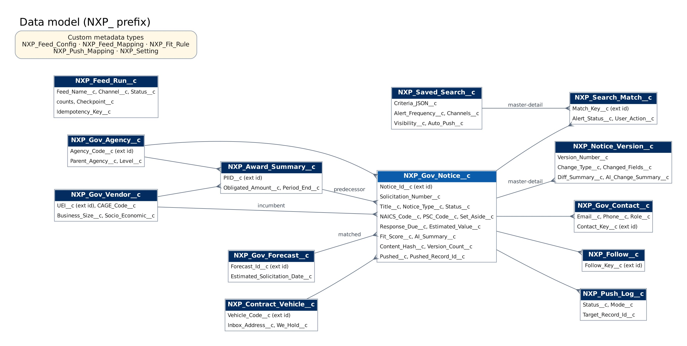

# Data model

## Objects

| Object                     | Package | Purpose                                                                           | Key fields                                                                                                                                                                                                                                                                                                                                                                                                                                                                                                                                                                                                                                                                                                                                                                                         |
| -------------------------- | ------- | --------------------------------------------------------------------------------- | -------------------------------------------------------------------------------------------------------------------------------------------------------------------------------------------------------------------------------------------------------------------------------------------------------------------------------------------------------------------------------------------------------------------------------------------------------------------------------------------------------------------------------------------------------------------------------------------------------------------------------------------------------------------------------------------------------------------------------------------------------------------------------------------------- |
| `NXP_Gov_Notice__c`        | core    | One opportunity notice from any channel                                           | `Notice_Id__c` (unique ext id), `Solicitation_Number__c` (ext id), `Title__c`, `Notice_Type__c`, `Status__c`, `Market__c`, `Agency__c`, `Agency_Path__c`, `NAICS_Code__c`, `PSC_Code__c`, `Set_Aside__c`, `Estimated_Value__c`, `Posted_Date__c`, `Response_Due__c`, `Days_To_Respond__c` (formula), `Description__c`, `Needs_Description__c`, `Source_Feed__c`, `Source_Lineage__c`, `Fit_Score__c`, `Fit_Breakdown__c`, `AI_Summary__c`, `AI_Summary_Status__c`, `Content_Hash__c`, `Version_Count__c`, `Last_Change_Type__c`, `Pushed__c`, `Pushed_Record_Id__c`, `Office__c`, `Contract_Vehicle__c`, `Contract_Vehicle_Code__c` (formula), `Incumbent__c`, `Predecessor_Award__c`, `Forecast__c`, `Push_Details__c` (formula, pushed as the description), `Fit_Band__c` (formula, for reports) |
| `NXP_Notice_Version__c`    | core    | Snapshot per amendment (master-detail)                                            | `Version_Number__c`, `Change_Type__c`, `Changed_Fields__c`, `Diff_Summary__c`, `Snapshot__c`, `AI_Change_Summary__c`                                                                                                                                                                                                                                                                                                                                                                                                                                                                                                                                                                                                                                                                               |
| `NXP_Gov_Agency__c`        | core    | Buyer hierarchy                                                                   | `Agency_Code__c` (unique), `Parent_Agency__c`, `Level__c`, `Full_Path__c`                                                                                                                                                                                                                                                                                                                                                                                                                                                                                                                                                                                                                                                                                                                          |
| `NXP_Gov_Contact__c`       | core    | Notice points of contact                                                          | `Gov_Notice__c`, `Email__c`, `Phone__c`, `Role__c`, `Contact_Key__c` (unique)                                                                                                                                                                                                                                                                                                                                                                                                                                                                                                                                                                                                                                                                                                                      |
| `NXP_Gov_Vendor__c`        | core    | Company from SAM.gov Entity                                                       | `UEI__c` (unique), `CAGE_Code__c`, `Business_Size__c`, `Socio_Economic__c`, `Last_Synced__c`                                                                                                                                                                                                                                                                                                                                                                                                                                                                                                                                                                                                                                                                                                       |
| `NXP_Award_Summary__c`     | core    | Award copied to core when referenced                                              | `PIID__c` (unique), `Agency__c`, `Vendor__c`, `Obligated_Amount__c`, `Period_End__c`, `NAICS_Code__c`                                                                                                                                                                                                                                                                                                                                                                                                                                                                                                                                                                                                                                                                                              |
| `NXP_Gov_Forecast__c`      | core    | Planned procurement                                                               | `Forecast_Id__c` (unique), `Agency__c`, `Estimated_Solicitation_Date__c`, `Matched_Notice__c`                                                                                                                                                                                                                                                                                                                                                                                                                                                                                                                                                                                                                                                                                                      |
| `NXP_Contract_Vehicle__c`  | core    | GWAC, IDIQ, MAS, BPA                                                              | `Vehicle_Code__c` (unique), `We_Hold__c`, `Ceiling__c`, `Expiry_Date__c`, `Inbox_Address__c` (address eBuy e-mail is sent to)                                                                                                                                                                                                                                                                                                                                                                                                                                                                                                                                                                                                                                                                      |
| `NXP_Company_Profile__c`   | core    | What we sell; drives the fit score                                                | `Active__c`, `NAICS_Codes__c`, `PSC_Codes__c`, `Set_Asides__c`, `Target_Agency_Codes__c`, `Keywords__c`, `Vehicle_Codes__c`, `Min_Value__c`, `Max_Value__c`                                                                                                                                                                                                                                                                                                                                                                                                                                                                                                                                                                                                                                        |
| `NXP_Feed_Run__c`          | core    | One feed run or REST call                                                         | `Feed_Name__c`, `Channel__c`, `Status__c`, counts, `Checkpoint__c`, `Error_Log__c`, `Idempotency_Key__c` (unique), `Response_Body__c`                                                                                                                                                                                                                                                                                                                                                                                                                                                                                                                                                                                                                                                              |
| `NXP_Log__c`               | core    | Application log                                                                   | `Level__c`, `Source__c`, `Message__c`, `Stack_Trace__c`                                                                                                                                                                                                                                                                                                                                                                                                                                                                                                                                                                                                                                                                                                                                            |
| `NXP_Inbound_Email__c`     | core    | An e-mail received by the eBuy inbox (private, admins only); attachments as Files | `Message_Id__c` (unique), `From_Address__c`, `Subject__c`, `Body__c`, `Status__c`, `Status_Detail__c`, `RFQ_Number__c`, `Gov_Notice__c`, `Contract_Vehicle__c`, `Extraction_Method__c`, `Extracted_Json__c`                                                                                                                                                                                                                                                                                                                                                                                                                                                                                                                                                                                        |
| `NXP_Document_Analysis__c` | core    | What the Document Reader read from one file on a notice (master-detail)           | `Gov_Notice__c`, `Content_Document_Id__c`, `Analysis_Key__c` (unique), `File_Name__c`, `Status__c`, `Result_Json__c`, `Analyzed__c`                                                                                                                                                                                                                                                                                                                                                                                                                                                                                                                                                                                                                                                                |
| `NXP_Usage__c`             | core    | One row per user per week they opened a Nexus screen (private, admins only)       | `User__c`, `Week__c`, `Usage_Key__c` (unique), `Views__c`, `Screens__c`                                                                                                                                                                                                                                                                                                                                                                                                                                                                                                                                                                                                                                                                                                                            |
| `NXP_GovWin_Alert__c`      | core    | A GovWin alert loaded for the parallel run (admins)                               | `GovWin_Id__c` (unique), `Solicitation_Number__c`, `Alert_Date__c`, `Gov_Notice__c`, `Result__c`, `Search_Matches__c`                                                                                                                                                                                                                                                                                                                                                                                                                                                                                                                                                                                                                                                                              |
| `NXP_Saved_Search__c`      | search  | A user's search, alerts, auto-push                                                | `Criteria_JSON__c`, `Visibility__c`, `Team_Group__c`, `Alert_Frequency__c`, `Channels__c`, `Alert_On_Changes__c`, `Auto_Push__c`, `Auto_Push_Min_Fit__c`, `Active__c`, `Owner_Name__c` (formula, for reports)                                                                                                                                                                                                                                                                                                                                                                                                                                                                                                                                                                                      |
| `NXP_Search_Match__c`      | search  | Notice matched by a search (master-detail)                                        | `Gov_Notice__c`, `Match_Key__c` (unique), `Alert_Status__c`, `User_Action__c`, `Change_Type__c`, `Matched_Terms__c`                                                                                                                                                                                                                                                                                                                                                                                                                                                                                                                                                                                                                                                                                |
| `NXP_Follow__c`            | search  | User follows a notice or watches a forecast, award, vendor or agency              | `Gov_Notice__c`, `Forecast__c`, `Award__c`, `Vendor__c`, `Agency__c`, `Follow_Key__c` (unique)                                                                                                                                                                                                                                                                                                                                                                                                                                                                                                                                                                                                                                                                                                     |
| `NXP_Push_Log__c`          | push    | Each push and sync                                                                | `Gov_Notice__c`, `Target_Object__c`, `Target_Record_Id__c`, `Status__c`, `Mode__c`, `Pushed_By__c`, `Source__c` (where the push started), `Attempts__c`, `Error__c`                                                                                                                                                                                                                                                                                                                                                                                                                                                                                                                                                                                                                                |

## Custom metadata types (core)

| Type                    | Holds                                                                    | Shipped records                                                                                                              |
| ----------------------- | ------------------------------------------------------------------------ | ---------------------------------------------------------------------------------------------------------------------------- |
| `NXP_Feed_Config__mdt`  | Feed connector, credential, path, page size, lookback, interval, channel | SAM_Opportunities, SAM_Backfill, SAM_Entity, USAspending_Awards, Agency_Forecasts (inactive; switched on by env-config)      |
| `NXP_Feed_Mapping__mdt` | Source JSON path → target field + transform                              | SAM and forecast mappings                                                                                                    |
| `NXP_Fit_Rule__mdt`     | Rule type and weight                                                     | NAICS 30, Agency 20, Set-Aside 15, Keyword 20, Value Range 15 (PSC, Vehicle off; Vehicle scores notices on vehicles we hold) |
| `NXP_Push_Mapping__mdt` | Notice field → target field, required, sync behaviour                    | `TechnoMile_Default` set on Opportunity                                                                                      |
| `NXP_Setting__mdt`      | Key/value settings                                                       | Limits, retries, AI switches, listeners, template names, eBuy inbox (`Ebuy_*`) and Document Reader (`Document_*`) settings   |

## Platform event

`NXP_Gov_Notice_Changed__e` is published after commit and carries `Notice_Record_Id__c`, `Change_Type__c`, `Is_New__c` and `Source_Feed__c`. Search matching, watch alerts and post-push sync subscribe to it.

## Data Cloud

Bulk award history lands in Data Cloud through the `NXP_Awards` Ingestion API connector (`NXP_Award` schema). It is mapped from the DLO to an Award DMO for market analytics; see [Data Cloud ingestion](../integration/data-cloud-ingestion.md).
