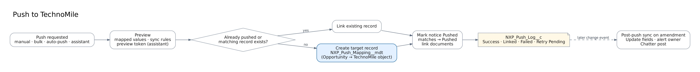

# Push to TechnoMile

## Modes

| Mode   | Started by                             | Runs as                    | Notes                                                  |
| ------ | -------------------------------------- | -------------------------- | ------------------------------------------------------ |
| Manual | Push button (Match Inbox, notice page) | User (user mode)           | Dialog shows mapped values, duplicate check, documents |
| Bulk   | Match Inbox _Push selected_            | User                       | Power Users only, up to 200                            |
| Auto   | `NXP_AutoPushListener` on new matches  | Search owner (system mode) | Saved search _Auto-push_: Fit Threshold or All Matches |
| Agent  | Nexus Pursuit Assistant                | User                       | Requires the preview token from _NXP Preview Push_     |
| Sync   | Change event on a pushed notice        | System                     | Applies sync rules                                     |

## Mapping (`NXP_Push_Mapping__mdt`)

Rows in the mapping set named by `NXP_Setting.Push_Mapping_Set` (default `TechnoMile_Default`):

| Field              | Meaning                                                                |
| ------------------ | ---------------------------------------------------------------------- |
| `Target_Object__c` | API name of TechnoMile's opportunity object (shipped as `Opportunity`) |
| `Source_Field__c`  | Gov Notice field; blank to use the default value only                  |
| `Target_Field__c`  | Field on the target object                                             |
| `Default_Value__c` | Used when the source is blank (for example the initial stage)          |
| `Required__c`      | Push fails with a clear message if there is no value                   |
| `Sync_Behavior__c` | `Update` (rewrite on amendment), `Alert Only` (notify owner), `Never`  |

Shipped rows: Title → Name, Response Due → CloseDate (Update), StageName default "Prospecting", Estimated Value → Amount (Alert Only), Notice URL → Description.

## Duplicate check

Before creating, the service looks for:

1. A notice already pushed (`Pushed_Record_Id__c`).
2. A target record whose mapped field equals the notice's `Solicitation_Number__c` or `Notice_Id__c`.

To turn on the second check, add a text field such as `NXP_Solicitation_Number__c` to the TechnoMile object, and add a mapping row from `Solicitation_Number__c` to that field.

## After the push

- The notice is marked Pushed, and the pushing user's matches for it become _Pushed_.
- Solicitation files are linked to the target record (viewer access).
- A Push Log row records mode, user, target and result. Failed auto-pushes are _Retry Pending_ and retried hourly up to `Push_Max_Attempts`.
- On each amendment:
    - _Update_ fields are rewritten.
    - The change is posted to the record feed.
    - The record owner gets a notification listing _Alert Only_ fields to review.
    - Capture fields such as stage and pWin are never touched.
