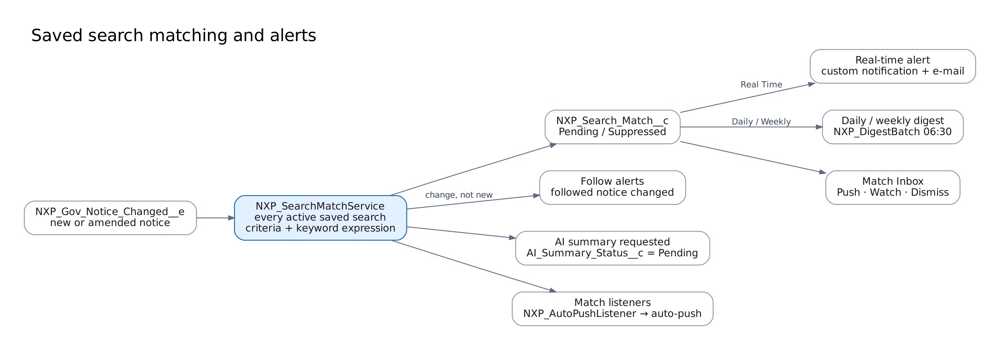

# Search and alerts



## Criteria JSON

Saved in `NXP_Saved_Search__c.Criteria_JSON__c`, parsed by `NXP_SearchCriteria`. Every key is optional, and an empty object matches every active notice.

```json
{
    "keywords": "cyber AND (\"zero trust\" OR ZTA) NOT training",
    "searchIn": ["title", "description"],
    "agencies": ["Homeland Security", "Customs and Border Protection"],
    "excludeAgencies": ["Coast Guard"],
    "naics": ["541512", "5415*"],
    "psc": ["DA01"],
    "setAsides": ["Small Business", "8(a)"],
    "noticeTypes": ["Solicitation", "Sources Sought"],
    "statuses": ["Active"],
    "markets": ["Federal"],
    "sources": ["SAM_Opportunities"],
    "places": ["VA", "DC"],
    "vehicles": ["OASIS+"],
    "minValue": 5000000,
    "maxValue": 100000000,
    "includeUnknownValue": true,
    "dueWithinDays": 45,
    "postedWithinDays": 30,
    "minFit": 60
}
```

| Key                                                              | Matching                                                                                                    |
| ---------------------------------------------------------------- | ----------------------------------------------------------------------------------------------------------- |
| `keywords`                                                       | Boolean expression over title and description (see below)                                                   |
| `agencies`, `excludeAgencies`, `setAsides`, `places`, `vehicles` | Case-insensitive "contains any" against agency path + office, set-aside, place of performance, vehicle code |
| `naics`, `psc`                                                   | Exact code or prefix ending in `*`                                                                          |
| `noticeTypes`, `statuses`, `markets`, `sources`                  | Exact values; `statuses` defaults to `Active`                                                               |
| `minValue`, `maxValue`                                           | Notices with no published value still match unless `includeUnknownValue` is `false`                         |
| `dueWithinDays`                                                  | Response due between now and now + N days                                                                   |
| `postedWithinDays`, `minFit`                                     | Posted date and fit score thresholds                                                                        |

## Keyword syntax

| Write                              | Means                    |
| ---------------------------------- | ------------------------ |
| `cyber cloud`                      | both words (implied AND) |
| `cyber AND cloud`                  | both words               |
| `cyber OR cloud`                   | either                   |
| `cyber NOT training`               | cyber without training   |
| `"zero trust"`                     | exact phrase             |
| `icam*`                            | words starting with icam |
| `(cloud OR hosting) AND migration` | grouping                 |

Matching is on whole words and ignores case and punctuation ("Zero-Trust" matches "zero trust"). Operators are not case-sensitive. Invalid expressions are rejected when the search is saved, with a clear message.

## Alerts

| Setting                   | Behaviour                                                                                                                            |
| ------------------------- | ------------------------------------------------------------------------------------------------------------------------------------ |
| Real Time                 | Custom notification (bell, mobile, Slack/Teams where the org forwards Salesforce notifications) plus e-mail, minutes after ingestion |
| Daily / Weekly            | One digest e-mail per user at 06:30 (weekly on Monday), a section per search                                                         |
| None                      | Matches appear in the Match Inbox only                                                                                               |
| Alert on changes          | An amendment to a matched notice sets the match back to Pending and shows the change type                                            |
| Follow / Watch            | A change to a followed notice sends a notification to the follower                                                                   |
| Watch a forecast          | When a notice is released from the forecast (`NXP_WatchService`)                                                                     |
| Watch a recompete (award) | When a likely follow-on notice is posted (same agency and NAICS, or the notice names the award as predecessor)                       |
| Watch a vendor            | When the vendor wins a new award                                                                                                     |
| Watch an agency           | When the agency or a sub-agency posts a new notice                                                                                   |

## Limits

`Max_Searches_Per_User` (50) and `Max_RealTime_Searches` (20) in `NXP_Setting` keep matching within CPU limits. Admins can raise them after checking load in UAT.

## Plain-English drafting

`NXP_CriteriaDraftService` recognizes the following without AI:

- **NAICS:** 6-digit codes.
- **Dollar thresholds:** "over $5M", "under $500k".
- **Deadlines:** "due in the next N days".
- **Set-asides:** small business, 8(a), HUBZone, SDVOSB, WOSB.
- **Notice types:** sources sought, RFI, solicitation and the like.
- **Agencies:** about 40 acronyms, such as DHS, CBP, VA and Army.
- **Frequency:** daily, weekly or real time.

Any other words become keywords. When AI is on, the assistant tries the `NXP_Search_Criteria_Draft` prompt template first and falls back to this service.
