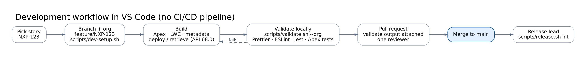

# Developer guide (VS Code)

## Set up once

| Tool                                           | Notes                                                                       |
| ---------------------------------------------- | --------------------------------------------------------------------------- |
| VS Code + Salesforce Extension Pack (Expanded) | Workspace recommendations in `.vscode/extensions.json`                      |
| Salesforce CLI `sf`                            | `npm install -g @salesforce/cli`; check with `sf version`                   |
| Node 20+                                       | `npm install` in the repo installs Prettier (Apex/XML), ESLint, Jest, Husky |
| Code Analyzer (optional)                       | `sf plugins install code-analyzer`                                          |
| Git                                            | Branch per story                                                            |

The project is pinned to **API 68.0**: `sourceApiVersion` in `sfdx-project.json`, `org-api-version` in `.sf/config.json`, and `<apiVersion>68.0</apiVersion>` in every `-meta.xml`. New files you create in VS Code must use 68.0.

```bash
git clone https://github.com/Hectorcaban-sudo/Nexus-Pursuit-Hub.git && cd Nexus-Pursuit-Hub
npm install
sf org login web --alias nxp-devhub --set-default-dev-hub   # or log in to your dev sandbox
```

## Daily loop



1. Branch: `git switch -c feature/NXP-123-short-name`.
2. Org: `scripts/dev-setup.sh` (scratch org with sample data), or `scripts/dev-setup.sh --org <sandbox>` where scratch orgs are not available, such as Government Cloud Dev Hubs. On Windows use `.\scripts\dev-setup.ps1` (every script has a [PowerShell twin](../../scripts/README.md)).
3. Build in VS Code. Deploy with _SFDX: Deploy This Source to Org_ or `sf project deploy start --source-dir packages/<pkg>`. Retrieve anything changed in Setup back into the branch.
4. Validate: `scripts/validate.sh --org nxp-dev`. It runs Prettier, ESLint, Jest, Code Analyzer and a check-only deploy with local Apex tests.
5. Commit (the pre-commit hook formats staged files), push and open a PR with the `validate.sh` output.

## Coding standards

- Prefix everything `NXP_` (LWC `nxp`). Reviewers reject anything without it.
- Apex layering: trigger → handler → service → selector. No SOQL or DML in triggers or loops.
- User mode for anything a person sees (`WITH USER_MODE`, `as user`). If a class must run in system mode, say why in its header comment.
- Put configuration in custom metadata (`NXP_Setting`, `NXP_Feed_Config`, `NXP_Push_Mapping`, `NXP_Fit_Rule`), never in constants.
- Callouts before DML in every transaction. One page per transaction.
- Log with `NXP_Logger`, and `flush()` at the end of jobs, REST calls and controllers.
- Every class has a test; aim for 85% coverage per package and 100% of `NXP_SearchMatchService` and `NXP_PushService` branches.
- LWCs: SLDS and base components, no `innerHTML`, getters instead of template expressions, a Jest test per component.

## Where things go

| Change                         | Package                                                                                            |
| ------------------------------ | -------------------------------------------------------------------------------------------------- |
| New field on Gov Notice        | `nxp-core` (then add it to `NXP_GovNoticeSelector.FIELDS` and the permission set generator)        |
| New feed                       | `nxp-ingestion` (see [feeds and connectors](../integration/feeds-and-connectors.md#adding-a-feed)) |
| Search or alert behaviour      | `nxp-search`                                                                                       |
| Push behaviour or target       | `nxp-push` (mapping first, code last)                                                              |
| Screens                        | `nxp-experience`                                                                                   |
| Agent actions, permission sets | `nxp-agents`                                                                                       |

## Useful commands

```bash
sf apex run --file scripts/apex/run-feed-now.apex --target-org nxp-dev     # start a feed
sf apex run --file scripts/apex/feed-health.apex --target-org nxp-dev      # last runs and jobs
sf apex run --file scripts/apex/rescore-notices.apex --target-org nxp-dev  # after fit rule changes
scripts/load-sample-data.sh --org nxp-dev --reset                         # fresh sample data
scripts/test-functional.sh --org nxp-dev                                  # end-to-end checks
sf apex run test --class-names NXP_IngestionTest --result-format human --target-org nxp-dev
npm run test:unit                                                           # LWC Jest
docs/diagrams/src/render.sh                                                 # rebuild JPG diagrams
```

## Debugging

- **Feed problems:** open the Feed Console, or query `NXP_Feed_Run__c` (`Error_Log__c`) and `NXP_Log__c`.
- **Apex Replay Debugger:** a launch config is in `.vscode/launch.json`. Set a trace flag, reproduce the problem, then run _SFDX: Get Apex Debug Logs_.
- **Platform event subscribers:** look in Setup → Platform Events → NXP Gov Notice Changed → Subscriptions, where you can also resume a suspended subscriber.
