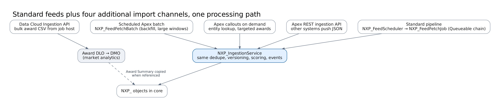
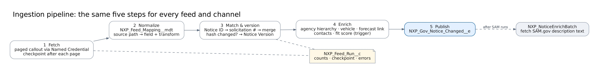

# Feeds and connectors

## Standard feeds

| Feed (`NXP_Feed_Config__mdt`) | Connector                     | Endpoint                                              | Channel           | Default interval                          | Lands in                             |
| ----------------------------- | ----------------------------- | ----------------------------------------------------- | ----------------- | ----------------------------------------- | ------------------------------------ |
| `SAM_Opportunities`           | `NXP_SamOpportunityConnector` | `NXP_SAM_Gov` `/opportunities/v2/search`              | Standard pipeline | 60 min, 2-day lookback                    | Gov Notice, Version, Contact, Agency |
| `SAM_Backfill`                | same                          | same                                                  | Scheduled batch   | daily, 30-day lookback                    | same                                 |
| `SAM_Entity`                  | `NXP_SamEntityConnector`      | `NXP_SAM_Gov` `/entity-information/v3/entities`       | Scheduled batch   | weekly, refreshes up to 500 stale vendors | Gov Vendor                           |
| `USAspending_Awards`          | `NXP_UsaSpendingConnector`    | `NXP_USAspending` `/api/v2/search/spending_by_award/` | Scheduled batch   | weekly, company-profile NAICS             | Award Summary, Vendor, Agency        |
| `Agency_Forecasts`            | `NXP_ForecastConnector`       | `NXP_Forecasts` (set URL per org)                     | Standard pipeline | weekly                                    | Gov Forecast                         |

All shipped configs are **inactive**; `env-config/<env>` switches them on per environment.

## Additional import channels

| Channel                  | Use it for                                                                                     | How                                                                                                                                             |
| ------------------------ | ---------------------------------------------------------------------------------------------- | ----------------------------------------------------------------------------------------------------------------------------------------------- |
| Apex REST ingestion API  | Systems that push notices (your own mail relay for vehicle task orders, SLED vendor, partners) | [REST ingestion API](rest-ingestion-api.md)                                                                                                     |
| Scheduled Apex batch     | Backfills, long windows, any feed with `Channel__c = Scheduled Batch`                          | `Database.executeBatch(new NXP_FeedFetchBatch('<feed>', null), 1)`                                                                              |
| Apex callouts on demand  | Single lookups (entity by UEI)                                                                 | `NXP_SamEntityConnector.lookup(uei)`                                                                                                            |
| Data Cloud Ingestion API | Bulk award history                                                                             | [Data Cloud ingestion](data-cloud-ingestion.md)                                                                                                 |
| Inbound e-mail (eBuy)    | GSA eBuy RFQ notifications, which have no API                                                  | Email Service `NXP_Ebuy_Inbox` → `NXP_EbuyEmailHandler` → `NXP_EbuyExtractJob`; see the [admin guide](../guides/admin-guide.md#gsa-ebuy-e-mail) |

Every channel hands records to `NXP_IngestionService`, so dedupe, versioning, fit scoring, matching, alerts and auto-push behave the same whichever channel loaded the data.

## The pipeline

1. **Fetch.** `NXP_FeedScheduler` (hourly at :05) starts each due feed. A Queueable fetches one page per job and chains to the next page, or a batch fetches one page per `execute()`. Retries cover 429 and 5xx, and the checkpoint is saved after every page.
2. **Normalize.** `NXP_FeedMapper` applies `NXP_Feed_Mapping__mdt` (source path, target field, transform `None|Date|DateTime|Number|Upper|Truncate`). The connector adds anything mapping can't express: notice type, status, agency path, place of performance, contacts.
3. **Match and version.** Records are matched on Notice ID, then solicitation number. If the hash of tracked fields changed, the service writes a Notice Version with field-level diffs and sets the change type (Due date, Set-aside, Classification, Scope, Status, Value, …).
4. **Enrich.** The service resolves the agency hierarchy (SAM.gov code path when available), contract vehicle and contacts, and links a matching forecast. The trigger computes the fit score.
5. **Publish.** It publishes `NXP_Gov_Notice_Changed__e`. After SAM.gov runs, `NXP_NoticeEnrichBatch` replaces description links with the text.

## Adding a feed

1. Write `NXP_<Source>Connector implements NXP_FeedConnector` with three methods: `init`, `initialCheckpoint` and `fetchPage`. Keep each page within 100 callouts and make no DML before the callouts.
2. Add a Named Credential (and External Credential if it needs authentication) under `packages/nxp-ingestion/main/default/`.
3. Add an `NXP_Feed_Config__mdt` record and its `NXP_Feed_Mapping__mdt` rows.
4. Add a test with an `HttpCalloutMock` (see `NXP_IngestionTest.Router`).
5. Switch it on in `env-config/<env>` and deploy.
